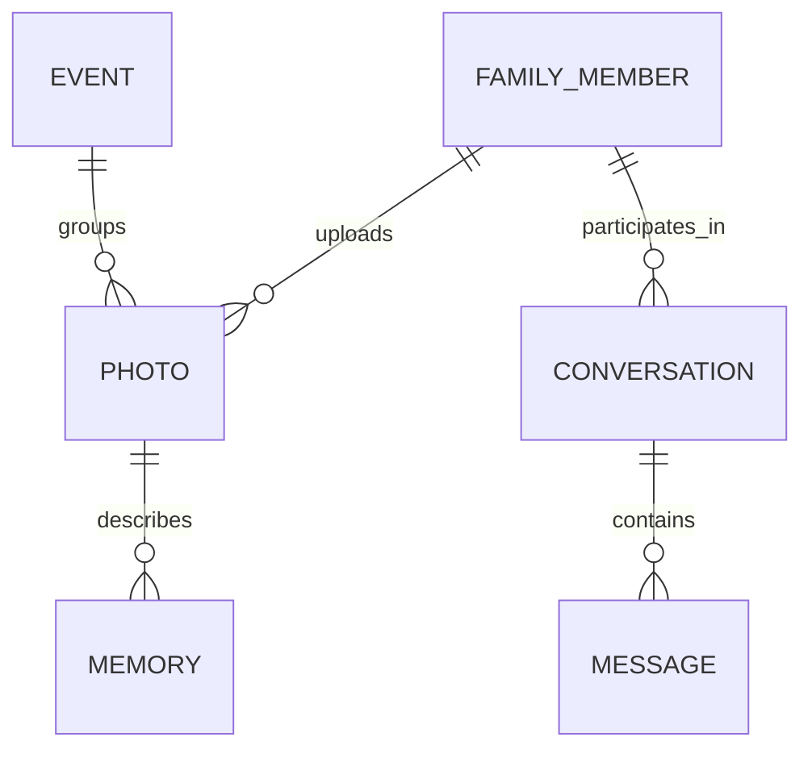
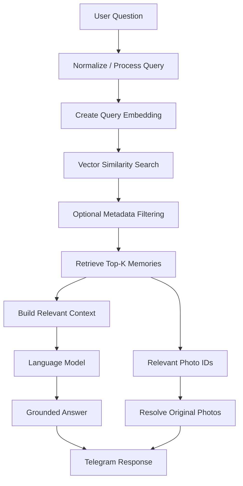

# Family Memory Assistant

> ### A Telegram-Based RAG Chatbot for Retrieving Family Memories and Photographs
>
> ## To see the screenshots from the working bot use these links:
https://drive.google.com/file/d/11JbtzEAq9kp64nROSLYBkLQISmy0Bc61/view?usp=sharing
https://drive.google.com/file/d/13uViKSVENt8E_hrfKE29UJcfZJh3x5xi/view?usp=sharing
https://drive.google.com/file/d/1oBga-6Ihq480I96pNoVgPKTjNkY15Ohi/view?usp=sharing
https://drive.google.com/file/d/1zdOz056aGPXqFtW1s14RxHhKBw45diMF/view?usp=sharing
https://drive.google.com/file/d/1k6Ko4q-8WOtXa4_qSo1OXvOkQaoEauuA/view?usp=sharing
https://drive.google.com/file/d/19bUAWpNoOCmRVZ3fZJB7iGzv7XStEtSz/view?usp=sharing

## Table of Contents

- [Overview](#overview)
- [Problem Statement](#problem-statement)
- [Project Goals](#project-goals)
- [Key Features](#key-features)
- [How It Works](#how-it-works)
- [System Architecture](#system-architecture)
- [Data Model](#data-model)
- [Retrieval-Augmented Generation (RAG)](#retrieval-augmented-generation-rag)
- [Project Structure](#project-structure)
- [Minimum Viable Product (MVP)](#minimum-viable-product-mvp)
- [Security and Privacy](#security-and-privacy)
- [Getting Started](#getting-started)
- [Environment Variables](#environment-variables)
- [Limitations and Future Improvements](#limitations-and-future-improvements)

## Overview

Family Memory Assistant is a private chatbot designed to help authorized family members organize, search, and revisit family memories through Telegram.

Family members will be able to upload photographs, add descriptions, associate photos with people and events, and ask questions in natural language. The system will retrieve relevant stored memories and, when available, return the associated photographs through Telegram.

The project uses **Retrieval-Augmented Generation (RAG)**. Instead of asking a language model to invent or guess family history, the backend will retrieve relevant records from the family-memory collection and use that evidence to generate an answer.


## Problem Statement

Family photographs and stories can become difficult to organize and retrieve as time passes. Photos may be scattered across devices or messaging applications, while their dates, locations, people, and stories are not consistently recorded. Searching for a specific event may require manually browsing many images or relying on someone's memory.

This project aims to provide a simple, conversational way to preserve family memories and retrieve relevant information using Telegram, structured metadata, semantic search, and grounded AI responses.

## Project Goals

- Provide a familiar Telegram interface for family members.
- Restrict access to approved users.
- Store photographs separately from their descriptive metadata.
- Record optional details such as dates, people, events, locations, and descriptions.
- Support structured and semantic memory search.
- Implement a real RAG pipeline using retrieved family data.
- Return relevant photographs alongside answers when matching photos exist.
- Support follow-up questions using conversation context.
- Keep the initial implementation small enough to build, understand, and test incrementally.

## Key Features

### core features

- **Private access:** identify Telegram users by their Telegram user ID and check authorization.
- **Photo upload:** receive photos through Telegram and store them safely.
- **Memory descriptions:** allow users to provide a description after uploading a photo.
- **Event organization:** associate photos with events such as birthdays, holidays, graduations, trips, and family gatherings.
- **Structured search:** find memories using available dates, event names, locations, or other metadata.
- **Semantic search:** retrieve memories based on meaning rather than exact keyword matches.
- **Grounded answers:** use retrieved records as evidence and say when sufficient information cannot be found.
- **Photo retrieval:** connect retrieved memory records to the original stored photographs.
- **Follow-up questions:** use recent conversation context to interpret references such as “that trip.”
- **Basic administration:** consider member approval and metadata management after the core system works.

## How It Works

A typical search is expected to follow this flow:

1. An authorized family member sends a question to the Telegram bot.
2. The bot passes the incoming update to the application.
3. The backend checks authorization and processes the request.
4. The retrieval system searches stored memory representations and applies relevant filters.
5. The backend assembles the most relevant records into context.
6. The language model generates an answer based on that context.
7. The backend resolves matching photo IDs to their stored images.
8. The bot sends the answer and relevant photographs to the user.

Example questions:

- “Show me pictures from Christmas 2023.”
- “When did we visit Hawassa with Grandma?”
- “Find memories about Dad’s birthday.”
- “Show me the pictures from that trip.”

If the system cannot find enough evidence, it should say so rather than inventing a family memory.

## System Architecture

The following diagram represents the **architecture**

```mermaid
flowchart TD
    U[Authorized Family Member] <--> TG[Telegram Bot]
    TG <--> API[Python Backend / FastAPI]
    API --> AUTH[Authorization Service]
    API --> DB[(Relational Database)]
    API --> STORE[Photo Storage]
    API --> RET[Memory Retrieval Service]
    RET --> VDB[(Vector Store)]
    RET --> DB
    RET --> CTX[Relevant Memory Context]
    CTX --> LLM[LLM API]
    LLM --> ANS[Grounded Answer]
    DB --> MAP[Resolve Photo IDs]
    STORE --> MAP
    ANS --> RESP[Answer + Relevant Photos]
    MAP --> RESP
    RESP --> TG
```


### Component responsibilities

| Component | Responsibility |
|---|---|
| Telegram Bot | Receives user messages and photos; sends replies and images. |
| Backend API | Coordinates application logic and integrates the system components. |
| Authorization service | Allows only approved family members to access private data. |
| Relational database | Stores family members, photo metadata, events, and conversation records as needed. |
| Photo storage | Stores image files separately from relational metadata. |
| Vector store | Stores and searches embeddings of memory text. |
| Retrieval service | Finds relevant memories and returns their identifiers and metadata. |
| LLM API | Generates an answer using retrieved context. |

## Data Model

The initial data model should remain small and evolve only when a demonstrated requirement needs it.

### Candidate entities

- **FamilyMember:** internal ID, Telegram user ID, name, relationship, role, and account status.
- **Photo:** ID, storage path or key, uploader, upload timestamp, optional photo date, description, and visibility information.
- **Event:** ID, name, optional date, location, and description.
- **Memory:** searchable text associated with a photo, event, or other family record.
- **Conversation / Message:** optional records for managing recent conversational context.

### Conceptual relationships



## Retrieval-Augmented Generation (RAG)

The planned RAG pipeline is:



### Key principles

- Store searchable text representations that connect back to original records.
- Embed memory text and user questions using compatible embedding models.
- Retrieve relevant records before asking the LLM to answer.
- Keep retrieved photo or memory IDs so the backend can locate the corresponding images.
- Treat conversation history as context for interpreting follow-up questions, not as verified family history by itself.
- Instruct the LLM to admit when the retrieved evidence is insufficient.
- Evaluate retrieval and answer quality using real test results; do not invent evaluation metrics.

## Project Structure

```text
family-memory-assistant
├── .venv/
├── backend\app/
│   ├── __pycache__/
│   ├── database/
│   ├── rag/
│   ├── services/
│   ├── telegram_bot/
│   ├── __init__.py
│   ├── config.py
│   └── logging_setup.py
├── data/
├── .env
├── .env.example
├── .gitignore
├── backup-2026-10-26....
├── README.md
└── requirements.txt
```

## Minimum Viable Product (MVP)

The MVP is complete when an authorized family member can:

1. Start the Telegram bot and be checked for authorization.
2. Upload a photograph and provide a description.
3. Store the photo and its metadata.
4. Generate and store a searchable memory representation and embedding.
5. Search for the memory using natural language.
6. Retrieve relevant stored memories through vector search.
7. Receive an answer grounded in retrieved context.
8. Receive the relevant photograph through Telegram.
9. Ask a follow-up question that uses conversation context appropriately.
10. Be prevented from accessing the private system if unauthorized.
So the system fits the above.

## Security and Privacy

Family memories and photographs are private data. Security must be part of the design from the beginning.

- Authorize users using Telegram user IDs, not display names alone.
- Keep bot tokens and API keys in environment variables; never commit them.
- Provide an `.env.example` containing placeholder values only.
- Restrict database and photo access to the application and authorized users.
- Validate inputs and use parameterized database operations or ORM features.
- Avoid logging bot tokens, API keys, full private messages, or sensitive family details.
- Handle errors without exposing secrets, file paths, or internal implementation details.
- Plan how users can request deletion of photos and associated metadata.
- Use synthetic family data during early development and testing.
- Review the privacy and data-handling terms of any external embedding or LLM API before sending family descriptions to it.

## Getting Started

> **Status:** The full setup below is a planned guide. Commands and dependencies should be updated to match the implementation as it is built.

### Prerequisites

- Python version selected for the project.
- Git.
- A Telegram account and a bot created through Telegram's official BotFather.
- API credentials for the selected embedding and language-model services, if using hosted APIs.

### 1. Clone the repository

```bash
git clone <your-repository-url>
cd family-memory-assistant
```

Replace `<your-repository-url>` with the actual repository URL.

### 2. Create and activate a virtual environment

From the project root, create the environment:

```bash
python -m venv .venv
```

On Windows Command Prompt:

```bat
.venv\Scripts\activate
```

On Windows PowerShell:

```powershell
.\.venv\Scripts\Activate.ps1
```

On Linux or macOS:

```bash
source .venv/bin/activate
```

### 3. Install dependencies

Once `requirements.txt` has been created and updated:

```bash
pip install -r requirements.txt
```

### 4. Configure environment variables

Create a local `.env` file based on `.env.example` and fill in the values required by the current implementation. Never commit `.env`.

### 5. Run the application

The exact command will depend on the entry point selected during implementation. For a FastAPI application with `app.main:app`, a possible development command from the `backend/` directory is:

```bash
uvicorn app.main:app --reload
```

This command should only be used once the relevant application module and dependencies exist.

### 6. Run tests

After tests have been added, run them from the appropriate project directory:

```bash
pytest
```

Record which tests actually pass. Do not interpret an unexecuted command as evidence that the application works.

## Environment Variables

The final names depend on the selected providers and configuration design. A possible `.env.example` is:

```dotenv
TELEGRAM_BOT_TOKEN=replace_with_your_bot_token
LLM_API_KEY=replace_with_your_llm_api_key
EMBEDDING_API_KEY=replace_if_required
DATABASE_URL=sqlite:///./family_memory.db
PHOTO_STORAGE_PATH=../data/photos
```

## Limitations and Future Improvements

Potential limitations of the initial version include:

- Search quality depends on the completeness and accuracy of descriptions and metadata.
- Embeddings can retrieve semantically similar text but cannot guarantee factual correctness.
- Follow-up interpretation can fail when conversation context is ambiguous.
- The initial version will not necessarily understand image contents unless visual analysis is added.
- Hosted AI services may introduce cost, latency, availability, and privacy considerations.

Possible future improvements:

- Hybrid keyword and semantic search.
- Better date, event, location, and people filters.
- Image captioning or multimodal search.
- A lightweight administrator interface.
- PostgreSQL or object storage when deployment requirements justify them.
- Better backup, retention, deletion, and recovery workflows.
- Expanded evaluation with a larger, carefully labeled benchmark.

